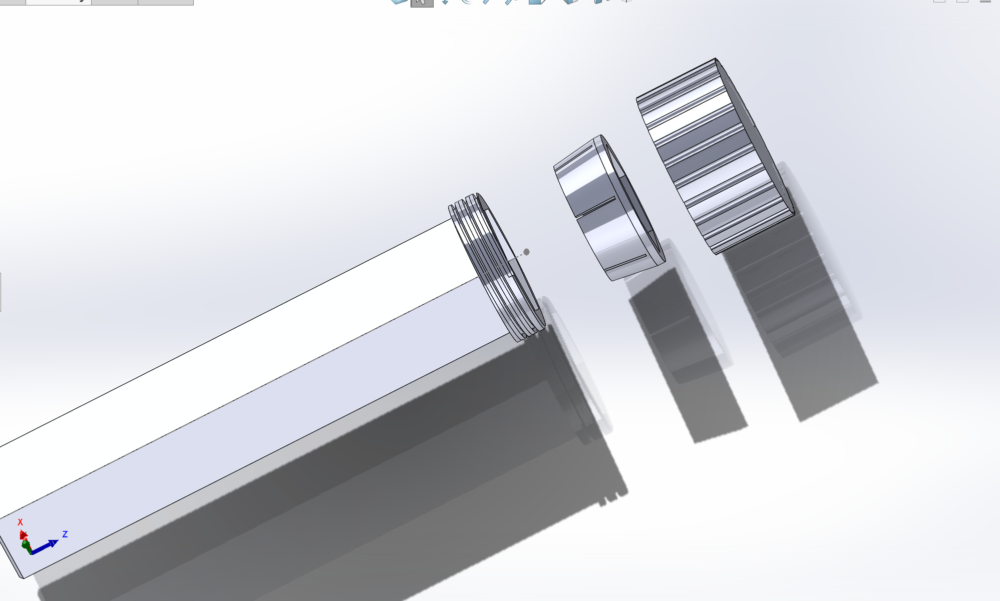

# Hacklide-Kinetic-Nexus
# Kinetic Nexus


**Kinetic Nexus** is a SolidWorks CAD project for a compact, four-stage hexagonal telescoping support system designed for FDM printing in PETG. The current milestone includes the complete T1-T4 tube set and a modeled J1 locking-joint prototype.

## Project status

### Completed

- Parametric telescoping tubes T1, T2, T3, and T4
- Configuration-specific tube lengths, outside AF dimensions, and bore AF dimensions
- T1 closed 2 mm bottom floor
- T2-T4 guide bands, pull-out stop bands, and relieved bodies
- Guide-band crush ribs, mouth chamfers, and corner fillets
- J1 external threaded boss integrated into T1
- Custom 3 mm-pitch trapezoidal external thread
- One-piece, six-finger J1 collet
- J1 locking nut with matching internal thread and 8 degree cone
- 24 external nut grip flutes
- J1 assembly and exploded view
- SolidWorks interference check confirming no interference between the T1 and nut threads at the tested phase

### Still to be completed

- J2 locking joint between T2 and T3
- J3 locking joint between T3 and T4
- Detents and ruler markings
- T1 grip and tripod mechanism
- Phone mount, tilt head, and clamp
- Full top-level product assembly
- Printed C1 clearance coupon and C2 thread/collet coupon
- Physical validation of torque, clamping force, cracking resistance, and pull-out strength

## Visual overview

### T1-T4 tube configurations


### J1 exploded view



## Tube dimensions

| Tube | Full AF | Bore AF | Length | Relieved AF |
|---|---:|---:|---:|---:|
| T1 | 32.00 mm | 28.00 mm | 145 mm | N/A |
| T2 | 27.55 mm | 23.55 mm | 165 mm | 26.35 mm |
| T3 | 23.10 mm | 19.10 mm | 187 mm | 21.90 mm |
| T4 | 18.65 mm | 14.65 mm | 201 mm | 17.45 mm |

T2-T4 use 6 mm guide bands, separate 6 mm pull-out stop bands, 0.60 mm relief per outside face, and twelve guide-band ribs per tube.

## J1 locking joint

J1 connects T1 and T2 and consists of three modeled components:

1. A round external threaded boss integrated into the upper 8 mm of T1
2. A separate one-piece six-finger tapered collet
3. A separate fluted locking nut with a matching internal thread and cone

### J1 thread geometry

| Parameter | T1 external thread | Nut internal thread |
|---|---:|---:|
| Pitch | 3.00 mm | 3.00 mm |
| Threaded height | 8.00 mm | 8.00 mm |
| Radial depth | 1.40 mm | 1.40 mm |
| Approximate turns | 2.667 | 2.667 |
| Flank angle | 20 degrees | 20 degrees |
| Major/root diameter | 38.10 / 35.30 mm | 38.70 / 35.90 mm |

### J1 collet

- Base OD: 35.60 mm
- Top OD: 32.23 mm
- Overall height: 14.00 mm
- Straight lip ring: 2.00 mm
- Flexible finger length: 12.00 mm
- Hex bore AF: 26.65 mm
- Six slits, each 0.80 mm wide
- Cone half-angle: 8 degrees

### J1 locking nut

- Outside diameter: 44.00 mm
- Overall height: 22.00 mm
- Internal thread region: 8.00 mm
- Straight cone land: 2.00 mm
- Internal cone region: 12.00 mm
- Cone base ID: 35.80 mm
- Cone top ID: 32.43 mm
- 24 grip flutes at 15 degree spacing

## Verification and limitations

The T1 external thread and locking-nut internal thread were isolated in SolidWorks Interference Detection. The tested thread pair reported **No Interferences**.

The rigid CAD collet can intersect the nut cone in a tightened position because a standard SolidWorks assembly does not reproduce elastic PETG finger deflection. The one-piece collet therefore remains a CAD concept pending physical C2 coupon testing.

The project has **not yet completed physical manufacturing validation**. Before relying on the locking mechanism, the following tests are required:

- Thread fit and nut torque
- Collet flexibility and crack resistance
- Axial holding force
- Stop-band pull-out strength
- Repeated lock/unlock cycling

## Repository structure

```text
Hacklide-Kinetic-Nexus/
├── README.md
├── JOURNAL.md
├── BOM.csv
├── LICENSE
├── assets/
│   ├── J1_asembly.png
│   ├── T1-T¤ config.png
│   └── j1-exploded.png
├── Cad/
│   ├── native-solidworks/
│   │   ├── Kinetic_Nexus_J1_Collet.SLDPRT
│   │   ├── Kinetic_Nexus_J1_Locking_Nut.SLDPRT
│   │   ├── Kinetic_Nexus_J1_Test_Assembly.SLDASM
│   │   └── Kinetic_Nexus_Tubes_T1-T4+J1_FINAL.SLDPRT
│   └── step/
│       └── STEP exports for cross-platform CAD access
└── docs/
    ├── build specification
    ├── SolidWorks handoff
    └── equation notes
```

## Opening the CAD

### SolidWorks

Open the native assembly from:

```text
Cad/native-solidworks/Kinetic_Nexus_J1_Test_Assembly.SLDASM
```

Keep all referenced `.SLDPRT` files in the same repository folder structure so SolidWorks can resolve the assembly components.

### Other CAD software

Use the neutral exports in:

```text
Cad/step/
```

The STEP files provide editable solid geometry for CAD software that cannot open native SolidWorks files.

## Documentation

- [`JOURNAL.md`](JOURNAL.md) records project development.
- BOM.csv is reserved for the project bill of materials and will be completed as hardware and manufacturing requirements are finalized.
- 

- [`docs/`](docs/) contains the build specification, handoff document, and equation notes.

## License

See [`LICENSE`](LICENSE).

## Author

Designed and modeled by Sergel Hasabella.
